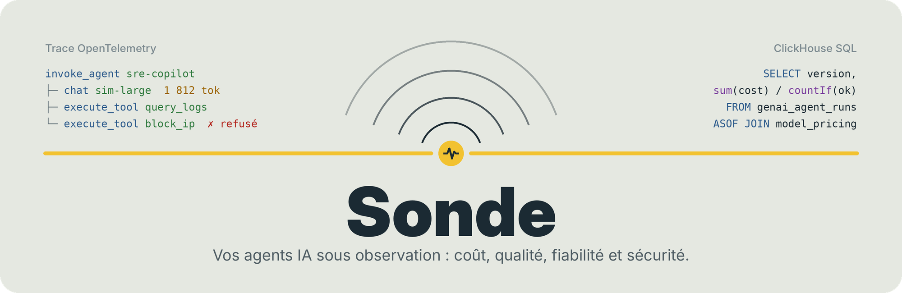
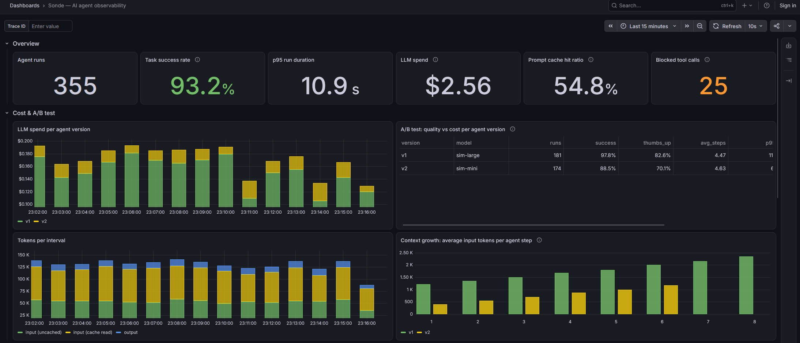

<p align="center">
  <picture>
    <source media="(prefers-color-scheme: dark)" srcset="docs/assets/banner-dark.png">
    
  </picture>
</p>

<p align="center">
  <b>Un agent IA boucle, appelle des outils qu’on ne lui a pas donnés, laisse fuiter des données dans ses prompts et consomme des tokens en silence.<br>
  Sonde rend tout cela visible, avec des standards ouverts, en une commande.</b>
</p>

<p align="center">
  <a href="https://github.com/OlivMartins/sonde/releases/latest"></a>
  <a href="https://github.com/OlivMartins/sonde/actions/workflows/ci.yml"></a>
  <a href="LICENSE"></a>
  
  
  
</p>

<p align="center">
  <a href="#démarrer"><b>Démarrer</b></a>
  &nbsp;&nbsp;|&nbsp;&nbsp;
  <a href="#brancher-votre-propre-agent"><b>Brancher votre agent</b></a>
  &nbsp;&nbsp;|&nbsp;&nbsp;
  <a href="#interopérabilité"><b>Interopérabilité</b></a>
  &nbsp;&nbsp;|&nbsp;&nbsp;
  <a href="docs/ARCHITECTURE.md"><b>Architecture</b></a>
  &nbsp;&nbsp;|&nbsp;&nbsp;
  <a href="docs/sql-cookbook.md"><b>Requêtes SQL</b></a>
</p>

<br>

## En bref

Sonde est un socle d’observabilité pour agents IA, prêt à l’emploi :

**votre agent → OpenTelemetry → Collector (normalisation, liste blanche, masquage) → ClickHouse → Grafana**

Il est livré avec un agent de démonstration : un copilote SRE qui enquête sur des incidents simulés, délègue l’analyse des journaux à un sous-agent et teste deux versions de lui-même en A/B. Un LLM juge note ses réponses en arrière-plan. Un faux LLM joue le rôle du fournisseur : latence, tokens, cache de prompt, limites de débit, boucles, appels d’outils hallucinés et réponses bâclées. Aucune clé d’API n’est nécessaire.

<table>
<tr>
<td width="33%" valign="top">

**Combien ça coûte**

Coût par exécution, par tâche réussie et **par bonne réponse**, sous-agents compris, pour chaque version de l’agent. Les chiffres restent exacts même quand les traces brutes sont échantillonnées.

</td>
<td width="33%" valign="top">

**Est-ce que ça marche**

Taux de succès, boucles, latence, et la note d’un juge LLM qui tourne hors du chemin de l’agent. Et la justesse des chiffres eux-mêmes : appels sans tokens, spans orphelins, conversations fragmentées, avec alertes.

</td>
<td width="33%" valign="top">

**Est-ce que c’est sûr**

Le contenu n’est capturé qu’en cas d’échec. Le collector ne garde que les attributs autorisés et masque e-mails, clés et jetons. Les outils hors liste sont refusés et tracés.

</td>
</tr>
</table>

<p align="center">
  
</p>

## Démarrer

Il suffit de Docker avec Compose v2.

```bash
git clone https://github.com/OlivMartins/sonde.git && cd sonde
docker compose up -d --build
```

Ouvrez <http://localhost:3000> : le tableau de bord s’affiche directement, et les premières données arrivent en moins d’une minute.

Le `Makefile` fournit des raccourcis (`make up`, `make chaos`…). Il est facultatif : chaque raccourci correspond à une commande Docker.

| Effet | Commande | Raccourci |
| --- | --- | --- |
| Provoquer des limites de débit et des erreurs côté LLM | `curl -X POST localhost:8080/admin/faults -d '{"rate_limit_rate": 0.4}'` | `make chaos` |
| Revenir à la normale | `curl -X POST localhost:8080/admin/faults -d '{"rate_limit_rate": 0.04}'` | `make calm` |
| Suivre l’agent, une ligne par exécution | `docker compose logs -f agent` | `make logs` |
| Suivre le juge | `docker compose logs -f evaluator` | `make evals` |
| Échantillonner les traces brutes, chiffres intacts | `docker compose -f docker-compose.yml -f docker-compose.sampling.yml up -d --build` | `make up-sampling` |
| Ouvrir un shell ClickHouse | `docker compose exec clickhouse clickhouse-client -u sonde --password sonde -d otel` | `make sql` |
| Démarrer le socle seul, sans l’agent de démonstration | `docker compose up -d clickhouse otel-collector grafana` | `make infra` |
| Tout arrêter et supprimer les données | `docker compose -f docker-compose.yml -f docker-compose.sampling.yml down -v` | `make clean` |

## Brancher votre propre agent

Le socle accepte toute application qui émet de l’OTLP. Pointez votre SDK OpenTelemetry vers le collector :

```bash
docker compose up -d clickhouse otel-collector grafana   # le socle, sans l’agent de démo
export OTEL_EXPORTER_OTLP_ENDPOINT=http://localhost:4318
```

Les spans qui suivent les [conventions GenAI d’OpenTelemetry](https://github.com/open-telemetry/semantic-conventions-genai) (`gen_ai.operation.name`, `gen_ai.usage.*`, `gen_ai.tool.name`…) arrivent automatiquement dans les tables typées et sur le tableau de bord. Les noms plus anciens (`gen_ai.system`, `gen_ai.usage.prompt_tokens`…) sont convertis au passage.

Deux points à connaître :
- **Ventiler par agent** : posez `gen_ai.agent.name` et `gen_ai.agent.version` sur chaque span. [`telemetry.py`](agent/sonde_agent/telemetry.py) montre comment, et [`delegation.py`](agent/sonde_agent/delegation.py) comment garder le contexte quand un sous-agent part dans un thread.
- **Liste blanche** : le collector supprime les attributs qu’il ne connaît pas. Ajoutez les vôtres dans [`otel-collector/config.yaml`](otel-collector/config.yaml) ; le panneau « Attributs supprimés » montre ce qui est écarté.

Pour tracer un vrai modèle plutôt que le simulateur, n’importe quelle API compatible OpenAI convient. Exemple avec Ollama :

```bash
LLM_BASE_URL=http://host.docker.internal:11434/v1 LLM_PROVIDER=ollama \
AGENT_V1_MODEL=qwen3:8b AGENT_V2_MODEL=llama3.2:3b docker compose up -d agent
```

## Interopérabilité

Sonde ne remplace pas une plateforme comme Langfuse ou Arize Phoenix, il peut les alimenter. Une surcouche de configuration du collector leur envoie une copie des traces, après normalisation, liste blanche et masquage : vos règles de confidentialité s’appliquent avant que quoi que ce soit ne quitte la machine.

```bash
otelcol --config=config.yaml --config=overlays/langfuse.yaml   # ou overlays/phoenix.yaml
```

Les variables à renseigner et un exemple pour Docker Compose sont dans [docs/ARCHITECTURE.md](docs/ARCHITECTURE.md#interopérabilité).

## Comment c’est construit

| Brique | Rôle |
| --- | --- |
| `agent/` | Agent Python à outils, instrumenté à la main selon les conventions GenAI, générateur de charge et évaluateur asynchrone (LLM juge) |
| `fake-llm/` | Simulateur compatible OpenAI, juge compris, pannes réglables à chaud sur `/admin/faults` |
| `otel-collector/` | Réception OTLP, normalisation, liste blanche et masquage, écriture par lots dans ClickHouse ; gateway d’échantillonnage et surcouches d’export |
| `clickhouse/initdb/` | Tout le modèle de données : spans bruts, vues matérialisées, agrégats, prix, évaluations |
| `grafana/` | Source de données provisionnée, tableau de bord et alertes générés par du code |

Les traces sont la seule source de vérité : ClickHouse les transforme en tables typées, puis en agrégats à la minute, au moment même de l’insertion. Ces vues lisent un flux qui voit passer 100 % des spans, si bien qu’on peut échantillonner les traces brutes sans fausser un seul chiffre. Les choix de conception, le détail des attributs, les [limites connues](docs/ARCHITECTURE.md#limites-connues) et les pistes pour la production sont décrits dans [docs/ARCHITECTURE.md](docs/ARCHITECTURE.md).

## Tests

```bash
make dev && make lint && make test
```

Les traces de l’agent sont vérifiées span par span, sous-agents et modes de capture compris. Des exécutions sont ensuite rejouées dans ClickHouse embarqué ([chDB](https://github.com/chdb-io/chdb)), exactement comme les écrit le collector, puis notées par l’évaluateur : chaque vue, chaque panneau, chaque alerte et chaque requête de la documentation y est exécuté. La CI démarre enfin la stack complète, y envoie un span au format ancien et vérifie qu’il ressort normalisé, filtré et masqué. Elle recommence avec l’échantillonnage en queue : les échecs doivent être gardés et les chiffres rester exacts.

## D’où vient Sonde

Après avoir utilisé LangSmith, j’ai voulu comprendre ce que font vraiment les plateformes d’observabilité IA, de Langfuse à Arize Phoenix en passant par SigNoz. Comment une exécution d’agent devient-elle une trace ? Où se calcule son coût ? Que deviennent les prompts ? Que perd-on en échantillonnant ? Comment note-t-on une réponse ? Le plus sûr moyen de le savoir était de refaire le chemin moi-même, pièce par pièce, avec des standards ouverts.

Sonde n’est donc pas un concurrent de ces outils, plutôt leur vue éclatée : chaque choix y est visible, testé et réversible. Et comme il parle OpenTelemetry, il peut leur envoyer ses traces.

## Licence

Apache 2.0. Voir [LICENSE](LICENSE).
