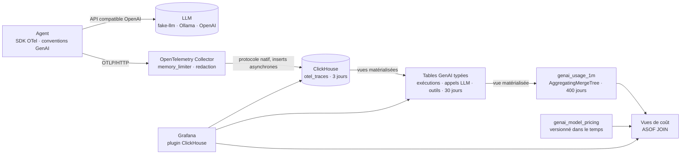

# Architecture

## Vue d’ensemble



## Ce qui est tracé

```text
invoke_agent sre-copilot               INTERNAL  issue, étapes, tokens cumulés, retour utilisateur
├── chat sim-large                     CLIENT    modèle, tokens (entrée / sortie / cache), raison d’arrêt, tentatives
│   └── POST /v1/chat/completions      CLIENT    un span par tentative HTTP (instrumentation httpx)
├── execute_tool get_service_metrics   INTERNAL  outil, identifiant d’appel, arguments / résultat (sur option)
├── execute_tool block_ip_address      INTERNAL  ✗ tool_not_allowed : refusé par la liste autorisée
├── chat sim-large
└── ...
```

| Attributs | Origine | Usage |
| --- | --- | --- |
| `gen_ai.operation.name`, `gen_ai.provider.name`, `gen_ai.request.model`, `gen_ai.response.model` | conventions GenAI | aiguillage des spans vers les tables typées |
| `gen_ai.usage.input_tokens`, `gen_ai.usage.output_tokens`, `gen_ai.usage.cache_read.input_tokens` | conventions GenAI | coût, taux de cache |
| `gen_ai.agent.name`, `gen_ai.agent.version`, `gen_ai.conversation.id` | conventions GenAI | analyse A/B, posés sur chaque span d’une exécution |
| `gen_ai.tool.name`, `gen_ai.tool.call.id` | conventions GenAI | fiabilité des outils |
| `gen_ai.input.messages`, `gen_ai.output.messages`, `gen_ai.tool.call.arguments`, `gen_ai.tool.call.result` | conventions GenAI, **sur option** | débogage ; masqués par le collector |
| `error.type` | conventions générales | `429`, `TimeoutError`, `tool_not_allowed`, `max_steps_exceeded`… |
| `sonde.agent.outcome`, `sonde.agent.step`, `sonde.llm.retries`, `sonde.tool.blocked`, `sonde.feedback.score` | propres au projet | faits de la boucle d’agent que les conventions ne couvrent pas encore |

Les conventions GenAI sont encore au statut *Development*. Tous les noms d’attributs sont rassemblés dans [`semconv.py`](../agent/sonde_agent/semconv.py) : un renommage se corrige en une ligne.

## Choix de conception

1. **Les traces sont la seule source de vérité.** L’agent n’émet aucune métrique. Des vues matérialisées ClickHouse transforment les spans en tables typées à l’insertion, puis en agrégats à la minute. Pas de limite de cardinalité, et tout nouvel indicateur se recalcule sur l’historique.
2. **Le schéma est maîtrisé, pas généré.** L’exportateur tourne avec `create_schema: false` ; le DDL est versionné dans `clickhouse/initdb/`, compatible colonne à colonne avec l’exportateur. La rétention est étagée : spans bruts 3 jours, tables typées 30 jours, agrégats 400 jours.
3. **Le coût se calcule à la lecture, à partir de prix versionnés.** Un changement de tarif est un `INSERT` daté ; un `ASOF JOIN` applique à chaque minute le prix en vigueur, sans jamais rejouer l’historique.
4. **Le contenu sensible est optionnel et masqué dans le pipeline.** La capture des messages suit l’option prévue par les conventions. Le processeur `redaction` du collector masque e-mails, secrets `clé=valeur` et jetons bearer avant stockage, pour tous les agents à la fois, sans casser les charges JSON.
5. **Rien ne fuit vers le fournisseur du LLM.** Les attributs d’exécution circulent dans le Context OpenTelemetry du processus, pas dans le Baggage, qui serait injecté dans les en-têtes HTTP sortants.
6. **Les agents sont bornés, et les bornes sont observables.** Un outil hors liste autorisée est refusé et tracé : un appel halluciné ou injecté apparaît sur un tableau de bord plutôt que dans une revue d’incident.
7. **Les lots sont constitués dans la file de l’exportateur** (`sending_queue.batch`), comme le recommande désormais l’exportateur ClickHouse, avec des inserts asynchrones côté serveur.

Exemple de ce que permet le modèle : le coût par tâche réussie, par version d’agent.

```sql
SELECT
    r.AgentVersion AS version,
    countIf(r.Outcome = 'completed') AS successes,
    round(sum(c.CostUsd) / nullIf(successes, 0), 4) AS usd_per_success
FROM otel.genai_agent_runs AS r
LEFT JOIN (SELECT TraceId, sum(CostUsd) AS CostUsd FROM otel.genai_llm_calls_priced GROUP BY TraceId) AS c
    ON r.TraceId = c.TraceId
GROUP BY version
ORDER BY version;
```

D’autres requêtes prêtes à l’emploi : [sql-cookbook.md](sql-cookbook.md).

## Tester

- **Traces de l’agent** : l’arbre de spans, les attributs, les tentatives, les outils refusés et la capture optionnelle sont vérifiés avec un exportateur en mémoire.
- **Couche ClickHouse, sans serveur** : des exécutions sont rejouées dans [chDB](https://github.com/chdb-io/chdb) exactement comme l’exportateur les écrit, masquage compris. Les tests vérifient les vues matérialisées, la cohérence des agrégats et des coûts, la validité du JSON après masquage, et exécutent chaque requête du tableau de bord et de la documentation.
- **Bout en bout en CI** : GitHub Actions valide la configuration du collector, démarre la stack, vérifie que les données circulent et qu’aucun secret n’atteint ClickHouse, puis interroge chaque panneau à travers l’API de Grafana.

## Passer en production

Sonde est dimensionné pour un poste de travail. Sur une vraie plateforme, il faudrait ajouter :

- **Des droits minimaux** : un utilisateur en insertion seule pour le collector, un utilisateur en lecture seule pour Grafana, TLS partout.
- **L’échantillonnage en fin de trace** dans une passerelle de collectors : garder 100 % des exécutions en échec, en boucle ou coûteuses, échantillonner le reste.
- **Un tampon Kafka** entre collectors et ClickHouse, pour absorber les pics et rejouer.
- **Des tables répliquées** (`ReplicatedMergeTree`, `cluster_name`) et le stockage objet pour les agrégats.
- **Des signaux de qualité** : scores d’évaluation (LLM juge, jeux de référence) reliés aux exécutions par `gen_ai.conversation.id`.
- **Des alertes** sur le coût par succès, le taux de boucles et les appels d’outils refusés.
