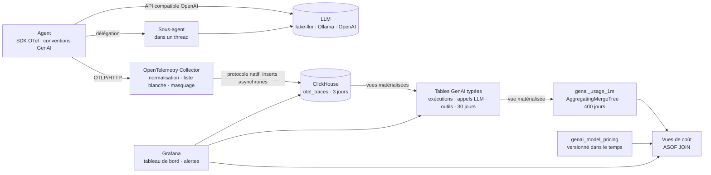

# Architecture

## Vue d’ensemble



## Ce qui est tracé

```text
invoke_agent sre-copilot                  INTERNAL  issue, étapes, tokens cumulés, retour utilisateur
├── chat sim-large                        CLIENT    modèle, tokens (entrée / sortie / cache), raison d’arrêt, tentatives
│   └── POST /v1/chat/completions         CLIENT    un span par tentative HTTP (instrumentation httpx)
├── execute_tool query_logs               INTERNAL  outil, identifiant d’appel, arguments / résultat (selon la capture)
├── execute_tool ask_log_analyst          INTERNAL  délégation à un sous-agent, exécuté dans un thread
│   └── invoke_agent log-analyst          INTERNAL  sonde.agent.parent = sre-copilot, même conversation
│       ├── chat sim-mini
│       └── execute_tool query_logs
├── execute_tool block_ip_address         INTERNAL  ✗ tool_not_allowed : refusé par la liste autorisée
└── ...
```

| Attributs | Origine | Usage |
| --- | --- | --- |
| `gen_ai.operation.name`, `gen_ai.provider.name`, `gen_ai.request.model`, `gen_ai.response.model` | conventions GenAI | aiguillage des spans vers les tables typées |
| `gen_ai.usage.input_tokens`, `gen_ai.usage.output_tokens`, `gen_ai.usage.cache_read.input_tokens` | conventions GenAI | coût, taux de cache |
| `gen_ai.agent.name`, `gen_ai.agent.version`, `gen_ai.conversation.id` | conventions GenAI | analyse A/B, posés sur chaque span d’une exécution |
| `gen_ai.tool.name`, `gen_ai.tool.call.id` | conventions GenAI | fiabilité des outils |
| `gen_ai.input.messages`, `gen_ai.output.messages`, `gen_ai.tool.call.arguments`, `gen_ai.tool.call.result` | conventions GenAI, **sur option** | débogage ; masqués par le collector |
| `error.type` | conventions générales | `429`, `TimeoutError`, `tool_not_allowed`, `max_steps_exceeded`… |
| `sonde.agent.outcome`, `sonde.agent.step`, `sonde.agent.parent`, `sonde.llm.retries`, `sonde.tool.blocked`, `sonde.feedback.score` | propres au projet | faits de la boucle d’agent que les conventions ne couvrent pas encore |
| `sonde.semconv.legacy`, `redaction.*.count` | ajoutés par le collector | qualité des données : renommages et attributs écartés |

Les conventions GenAI sont encore au statut *Development*. Côté agent, tous les noms sont rassemblés dans [`semconv.py`](../agent/sonde_agent/semconv.py). Côté plateforme, le collector convertit les noms anciens (voir plus bas).

## Choix de conception

1. **Les traces sont la seule source de vérité.** L’agent n’émet aucune métrique. Des vues matérialisées ClickHouse transforment les spans en tables typées à l’insertion, puis en agrégats à la minute. Pas de limite de cardinalité, et tout nouvel indicateur se recalcule sur l’historique.
2. **Le schéma est maîtrisé, pas généré.** L’exportateur tourne avec `create_schema: false` ; le DDL est versionné dans `clickhouse/initdb/`, compatible colonne à colonne avec l’exportateur. La rétention est étagée : spans bruts 3 jours, tables typées 30 jours, agrégats 400 jours.
3. **L’ingestion ne dépend pas des noms d’attributs.** Les spans bruts arrivent dans des colonnes `Map` : un attribut renommé ne casse aucun insert. Le risque est ailleurs, et il est silencieux : une vue lit une clé absente et écrit 0. D’où trois protections :
   - le processeur `transform/genai_normalize` du collector convertit les noms anciens ou tiers (`gen_ai.system`, `gen_ai.usage.prompt_tokens`, `llm.request.type`…) vers les conventions actuelles et marque les spans concernés ;
   - le tableau de bord suit la part d’appels LLM sans tokens et de spans sans agent, et une alerte se déclenche au-delà de 5 % ;
   - les spans bruts sont gardés 3 jours : après correction, on recalcule les tables typées par un `INSERT … SELECT`.
4. **Le coût se calcule à la lecture, à partir de prix versionnés.** Un changement de tarif est un `INSERT` daté ; un `ASOF JOIN` applique à chaque minute le prix en vigueur, sans jamais rejouer l’historique. Le coût d’une exécution inclut ses sous-agents, parce qu’ils partagent sa trace.
5. **Moins on collecte, moins on a à protéger.** La capture du contenu a trois modes (`SONDE_CAPTURE_CONTENT`) :
   - `off`, la valeur par défaut dans le code ;
   - `errors`, la valeur de la démo : le contenu n’est enregistré que pour un appel LLM en échec, un appel d’outil en échec ou refusé, et la transcription complète d’une exécution qui n’a pas abouti ;
   - `all`, pour le développement.
6. **Le collector filtre en liste blanche, puis masque.** Le processeur `redaction` ne garde que les attributs listés, sur les spans, les événements et les ressources ; tout le reste est supprimé et compté. Un test vérifie que chaque attribut émis par l’agent figure dans la liste. Les valeurs restantes passent ensuite par le masquage des e-mails, des secrets `clé=valeur` et des jetons bearer.
7. **Rien ne fuit vers le fournisseur du LLM.** Les attributs d’exécution circulent dans le Context OpenTelemetry du processus, pas dans le Baggage, qui serait injecté dans les en-têtes HTTP sortants.
8. **Le contexte suit les sous-agents, et sa perte se voit.** Le sous-agent `log-analyst` tourne dans un `ThreadPoolExecutor`, lancé avec `contextvars.copy_context().run`. Une faute injectable (`SONDE_FAULT_LOST_CONTEXT_RATE`) reproduit l’oubli classique. Le sous-agent démarre alors une trace détachée, que le tableau de bord et une alerte repèrent comme une conversation fragmentée.
9. **Les agents sont bornés, et les bornes sont observables.** Un outil hors liste autorisée est refusé et tracé : un appel halluciné ou injecté apparaît sur un tableau de bord plutôt que dans une revue d’incident.
10. **Les lots sont constitués dans la file de l’exportateur** (`sending_queue.batch`), comme le recommande désormais l’exportateur ClickHouse, avec des inserts asynchrones côté serveur.

Exemple de ce que permet le modèle : le coût par tâche réussie, par version d’agent.

```sql
SELECT
    r.AgentVersion AS version,
    countIf(r.Outcome = 'completed') AS successes,
    round(sum(c.CostUsd) / nullIf(successes, 0), 4) AS usd_per_success
FROM otel.genai_agent_runs AS r
LEFT JOIN (SELECT TraceId, sum(CostUsd) AS CostUsd FROM otel.genai_llm_calls_priced GROUP BY TraceId) AS c
    ON r.TraceId = c.TraceId
WHERE r.ParentAgent = ''
GROUP BY version
ORDER BY version;
```

D’autres requêtes prêtes à l’emploi : [sql-cookbook.md](sql-cookbook.md).

## Qualité des données

Un tableau de bord faux est plus dangereux qu’un tableau de bord en panne. La rangée « Qualité des données » et trois règles d’alerte Grafana surveillent les défaillances silencieuses :

| Signal | Ce qu’il révèle | Alerte |
| --- | --- | --- |
| Appels LLM sans tokens | un attribut `gen_ai.usage.*` renommé ou une instrumentation non conforme : le coût affiché est faux | au-delà de 5 % sur 15 min |
| Spans GenAI sans agent | des appels impossibles à attribuer, qui échappent au test A/B | — |
| Spans orphelins | un parent jamais arrivé : export perdu, plantage, échantillonnage incohérent | dès le premier |
| Conversations fragmentées | une conversation répartie sur plusieurs traces : le contexte n’a pas suivi un sous-agent | dès la première |
| Attributs hérités renommés | le travail de la normalisation, à surveiller lors d’une mise à jour de SDK | — |
| Attributs supprimés | la liste blanche écarte des attributs : une nouvelle instrumentation est à examiner | — |

Les requêtes du tableau de bord et des alertes sont générées par [`grafana/build_dashboard.py`](../grafana/build_dashboard.py) et exécutées par les tests.

## Limites connues

Ce que Sonde ne fait pas, ou fait partiellement, et ce qu’il faudrait en production.

**Le masquage par regex ne remplace pas une anonymisation.**
- Les expressions régulières ne reconnaissent que des formats connus : e-mails, `clé=valeur`, jetons bearer. Un nom, une adresse postale, un secret au format inhabituel ou encodé (base64, découpé, déguisé) passent.
- En streaming, si le contenu est capturé morceau par morceau, un secret coupé entre deux morceaux échappe au masquage. Sonde capture des messages complets.
- Un moteur NER comme Microsoft Presidio couvre mieux les données personnelles en texte libre, mais il est probabiliste, coûte du CPU, demande un modèle par langue et repose lui aussi sur des regex pour les secrets.

La défense principale reste de ne pas collecter : capture `off` ou `errors`, liste blanche, rétention courte, accès restreint aux colonnes de contenu. Un NER s’ajoute dans un étage dédié du pipeline, en complément.

**La normalisation ne connaît que les renommages déjà vus.** Elle couvre les anciens noms des conventions GenAI et quelques noms OpenLLMetry. Une nouvelle version du SDK peut en introduire d’autres : l’alerte « appels LLM sans tokens » le signale, puis on ajoute la correspondance. Le processeur `schema` du collector, encore en alpha, automatise ce genre de migration à partir des fichiers de schéma publiés par OpenTelemetry, mais les conventions GenAI, désormais dans leur propre dépôt, ne publient pas encore d’URL de schéma.

**La propagation du contexte se casse aux frontières.**
- `asyncio.create_task` et `asyncio.to_thread` copient le contexte.
- `ThreadPoolExecutor.submit`, `loop.run_in_executor`, les processus et les files de messages ne le copient pas.

Il faut alors `contextvars.copy_context().run`, l’instrumentation `threading` d’OpenTelemetry, ou la propagation de `traceparent` dans les messages. Pour un fan-out vers des agents distants, des liens de spans valent mieux qu’une hiérarchie forcée. Sonde détecte les conversations fragmentées et les spans orphelins, mais ne les recolle pas.

**Le reste du périmètre.**
- Un seul utilisateur ClickHouse, des identifiants par défaut et Grafana en accès anonyme : c’est un poste de travail, pas une plateforme partagée.
- La requête des spans orphelins balaie la période affichée. Sur un gros volume, elle doit s’appuyer sur `otel_traces_trace_id_ts` ou sur une vue matérialisée dédiée.
- Les retours utilisateurs et les prix des modèles simulés sont fictifs.

## Tester

- **Traces de l’agent** : l’arbre de spans, les attributs, les tentatives, les outils refusés, les trois modes de capture, le sous-agent dans un thread et la perte de contexte sont vérifiés avec un exportateur en mémoire.
- **Collector** : chaque attribut émis par l’agent doit figurer dans la liste blanche ; la normalisation s’exécute avant la redaction et ses cibles survivent au filtrage.
- **Couche ClickHouse, sans serveur** : des exécutions sont rejouées dans [chDB](https://github.com/chdb-io/chdb) exactement comme l’exportateur les écrit, liste blanche et masquage compris, avec deux spans parents volontairement perdus. Les tests vérifient les vues, la cohérence des coûts, la validité du JSON après masquage, les compteurs de qualité au span près, et exécutent chaque requête du tableau de bord, des alertes et de la documentation.
- **Bout en bout en CI** : la stack démarre, un span au format ancien est envoyé au collector puis retrouvé normalisé dans ClickHouse, sans ses attributs hors liste. La CI vérifie aussi qu’aucun secret n’atteint la base, que chaque panneau répond à travers Grafana et que les règles d’alerte s’évaluent sans erreur.

## Passer en production

- **Des droits minimaux** : un utilisateur en insertion seule pour le collector, un utilisateur en lecture seule pour Grafana, TLS partout.
- **L’échantillonnage en fin de trace** dans une passerelle de collectors : garder 100 % des exécutions en échec, en boucle ou coûteuses, échantillonner le reste. Il faut alors router par `TraceId`, sinon l’échantillonnage lui-même fabrique des orphelins.
- **Un tampon Kafka** entre collectors et ClickHouse, pour absorber les pics et rejouer.
- **Des tables répliquées** (`ReplicatedMergeTree`, `cluster_name`) et le stockage objet pour les agrégats.
- **Des signaux de qualité de réponse** : scores d’évaluation (LLM juge, jeux de référence) reliés aux exécutions par `gen_ai.conversation.id`.
- **Des notifications** : les règles d’alerte sont provisionnées, il reste à brancher un point de contact (Slack, PagerDuty, e-mail).
