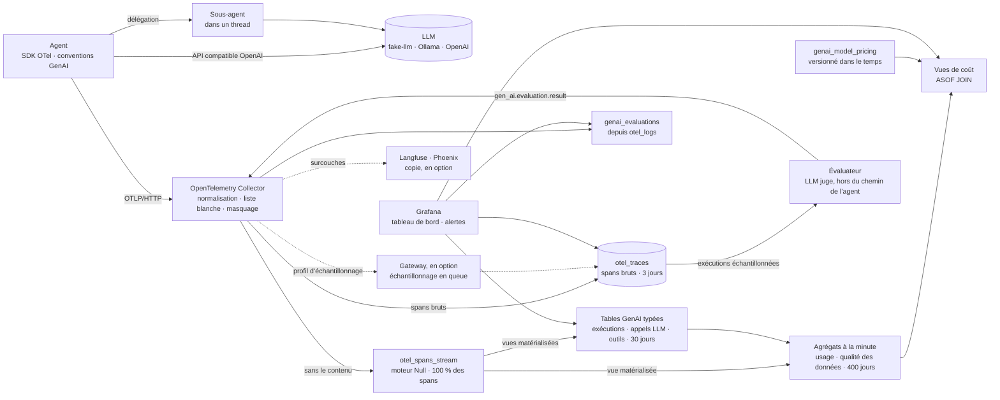

# Architecture

## Vue d’ensemble



## Ce qui est tracé

```text
invoke_agent sre-copilot                  INTERNAL  issue, étapes, tokens cumulés, retour utilisateur
├── chat sim-large                        CLIENT    modèle, tokens (entrée / sortie / cache), raison d’arrêt, tentatives
│   └── POST /v1/chat/completions         CLIENT    un span par tentative HTTP (instrumentation httpx)
├── execute_tool query_logs               INTERNAL  outil, identifiant d’appel, arguments / résultat (selon la capture)
├── execute_tool ask_log_analyst          INTERNAL  délégation à un sous-agent, exécuté dans un thread
│   └── invoke_agent log-analyst          INTERNAL  sonde.agent.parent = sre-copilot, même conversation
│       ├── chat sim-mini
│       └── execute_tool query_logs
├── execute_tool block_ip_address         INTERNAL  ✗ tool_not_allowed : refusé par la liste autorisée
└── ...

gen_ai.evaluation.result                  événement rattaché au span invoke_agent : note, verdict, explication
chat sim-judge                            CLIENT    l’appel du juge, dans sa propre trace, agent sonde-evaluator
```

| Attributs | Origine | Usage |
| --- | --- | --- |
| `gen_ai.operation.name`, `gen_ai.provider.name`, `gen_ai.request.model`, `gen_ai.response.model` | conventions GenAI | aiguillage des spans vers les tables typées |
| `gen_ai.usage.input_tokens`, `gen_ai.usage.output_tokens`, `gen_ai.usage.cache_read.input_tokens` | conventions GenAI | coût, taux de cache |
| `gen_ai.agent.name`, `gen_ai.agent.version`, `gen_ai.conversation.id` | conventions GenAI | analyse A/B, posés sur chaque span d’une exécution |
| `gen_ai.tool.name`, `gen_ai.tool.call.id` | conventions GenAI | fiabilité des outils |
| `gen_ai.input.messages`, `gen_ai.output.messages`, `gen_ai.tool.call.arguments`, `gen_ai.tool.call.result` | conventions GenAI, **sur option** | débogage et évaluation ; masqués par le collector |
| `gen_ai.evaluation.name`, `gen_ai.evaluation.score.value`, `gen_ai.evaluation.score.label`, `gen_ai.evaluation.explanation` | conventions GenAI, événement | qualité des réponses, notée par le juge |
| `error.type` | conventions générales | `429`, `TimeoutError`, `tool_not_allowed`, `max_steps_exceeded`… |
| `sonde.agent.outcome`, `sonde.agent.step`, `sonde.agent.parent`, `sonde.llm.retries`, `sonde.tool.blocked`, `sonde.feedback.score` | propres au projet | faits de la boucle d’agent que les conventions ne couvrent pas encore |
| `sonde.eval.sampled` | propre au projet | exécution retenue pour l’évaluation : sa question et sa réponse sont gardées |
| `sonde.semconv.legacy`, `redaction.*.count` | ajoutés par le collector | qualité des données : renommages et attributs écartés |

Les conventions GenAI sont encore au statut *Development*. Côté agent, tous les noms sont rassemblés dans [`semconv.py`](../agent/sonde_agent/semconv.py). Côté plateforme, le collector convertit les noms anciens (voir plus bas).

## Choix de conception

1. **Les traces sont la seule source de vérité.** L’agent n’émet aucune métrique. Des vues matérialisées ClickHouse transforment les spans en tables typées à l’insertion, puis en agrégats à la minute. Pas de limite de cardinalité, et tout nouvel indicateur se recalcule sur l’historique des spans bruts.
2. **Les chiffres voient 100 % des spans, même quand les spans bruts sont échantillonnés.** Le collector écrit chaque span deux fois. D’un côté `otel_spans_stream`, une table au moteur `Null` : elle ne stocke rien, mais chaque insert déclenche les vues matérialisées. De l’autre `otel_traces`, qui sert à l’exploration. La branche des agrégats perd au passage le contenu des messages (`transform/drop_content`), car les vues n’ont besoin que de noms et de nombres. On peut donc échantillonner, raccourcir ou couper les spans bruts sans fausser un seul coût.
3. **Le schéma est maîtrisé, pas généré.** Les exportateurs tournent avec `create_schema: false` ; le DDL est versionné dans `clickhouse/initdb/`, compatible colonne à colonne avec l’exportateur. La rétention est étagée : spans bruts 3 jours, tables typées 30 jours, agrégats et évaluations 400 jours.
4. **L’ingestion ne dépend pas des noms d’attributs.** Les spans bruts arrivent dans des colonnes `Map` : un attribut renommé ne casse aucun insert. Le risque est ailleurs, et il est silencieux : une vue lit une clé absente et écrit 0. D’où trois protections :
   - le processeur `transform/genai_normalize` du collector convertit les noms anciens ou tiers (`gen_ai.system`, `gen_ai.usage.prompt_tokens`, `llm.request.type`…) vers les conventions actuelles et marque les spans concernés ;
   - le tableau de bord suit la part d’appels LLM sans tokens et de spans sans agent, et une alerte se déclenche au-delà de 5 % ;
   - les spans bruts sont gardés 3 jours : après correction, on recalcule les tables typées par un `INSERT … SELECT`.
5. **Le coût se calcule à la lecture, à partir de prix versionnés.** Un changement de tarif est un `INSERT` daté ; un `ASOF JOIN` applique à chaque minute le prix en vigueur, sans jamais rejouer l’historique. Le coût d’une exécution inclut ses sous-agents, parce qu’ils partagent sa trace.
6. **Moins on collecte, moins on a à protéger.** La capture du contenu a trois modes (`SONDE_CAPTURE_CONTENT`) :
   - `off`, la valeur par défaut dans le code ;
   - `errors`, la valeur de la démo : le contenu n’est enregistré que pour un appel LLM en échec, un appel d’outil en échec ou refusé, et la transcription complète d’une exécution qui n’a pas abouti ;
   - `all`, pour le développement.

   À part, une fraction des exécutions abouties (`SONDE_EVAL_SAMPLE_RATE`) garde sa question et sa réponse finale, et rien d’autre, pour l’évaluation.
7. **Le collector filtre en liste blanche, puis masque.** Le processeur `redaction` ne garde que les attributs listés, sur les spans, les événements, les journaux et les ressources ; tout le reste est supprimé et compté. Un test vérifie que chaque attribut émis par l’agent et par l’évaluateur figure dans la liste. Les valeurs restantes passent ensuite par le masquage des e-mails, des secrets `clé=valeur` et des jetons bearer. Tout ce qui sort du collector, vers ClickHouse ou vers un autre outil, a déjà traversé ces deux étapes.
8. **Rien ne fuit vers le fournisseur du LLM.** Les attributs d’exécution circulent dans le Context OpenTelemetry du processus, pas dans le Baggage, qui serait injecté dans les en-têtes HTTP sortants.
9. **Le contexte suit les sous-agents, et sa perte se voit.** Le sous-agent `log-analyst` tourne dans un `ThreadPoolExecutor`, lancé avec `contextvars.copy_context().run`. Une faute injectable (`SONDE_FAULT_LOST_CONTEXT_RATE`) reproduit l’oubli classique. Le sous-agent démarre alors une trace détachée, que le tableau de bord et une alerte repèrent comme une conversation fragmentée.
10. **Les agents sont bornés, et les bornes sont observables.** Un outil hors liste autorisée est refusé et tracé : un appel halluciné ou injecté apparaît sur un tableau de bord plutôt que dans une revue d’incident.
11. **La qualité d’une réponse se juge hors du chemin de l’agent.** Un appel au juge prend des secondes et coûte des tokens : il ne doit ni ralentir l’agent, ni le faire échouer. L’évaluation est un service à part, qui lit ClickHouse et produit de la télémétrie standard (voir plus bas).
12. **Les lots sont constitués dans la file de l’exportateur** (`sending_queue.batch`), comme le recommande désormais l’exportateur ClickHouse, avec des inserts asynchrones côté serveur.

Exemple de ce que permet le modèle : le coût par tâche réussie, par version d’agent.

```sql
SELECT
    r.AgentVersion AS version,
    countIf(r.Outcome = 'completed') AS successes,
    round(sum(c.CostUsd) / nullIf(successes, 0), 4) AS usd_per_success
FROM otel.genai_agent_runs AS r
LEFT JOIN (SELECT TraceId, sum(CostUsd) AS CostUsd FROM otel.genai_llm_calls_priced GROUP BY TraceId) AS c
    ON r.TraceId = c.TraceId
WHERE r.ParentAgent = ''
GROUP BY version
ORDER BY version;
```

D’autres requêtes prêtes à l’emploi : [sql-cookbook.md](sql-cookbook.md).

## Évaluation des réponses

Une tâche « réussie » s’est terminée par une réponse ; rien ne dit que la réponse était bonne. Le copilote v2, moins cher, peut garder le même taux de succès et répondre moins bien. Seule une évaluation de la réponse le montre.

```text
agent ──▶ span invoke_agent avec sonde.eval.sampled, la question et la réponse (masquées par le collector)
                │
évaluateur ─────┘ lit ClickHouse toutes les 15 s, demande une note au juge (1 à 5)
    │
    └──▶ événement gen_ai.evaluation.result, rattaché au span évalué ──▶ otel_logs ──▶ genai_evaluations
```

- **Le juge note un échantillon.** `SONDE_EVAL_SAMPLE_RATE` (30 % dans la démo) décide quelles exécutions abouties gardent leur question et leur réponse. Le tableau de bord applique le taux de bonnes réponses de l’échantillon à toutes les exécutions abouties pour obtenir le **coût par bonne réponse**.
- **Le résultat suit les conventions.** L’événement `gen_ai.evaluation.result` porte `gen_ai.evaluation.name`, `gen_ai.evaluation.score.value`, `gen_ai.evaluation.score.label` et `gen_ai.evaluation.explanation`, avec le contexte du span évalué. N’importe quel outil qui lit ces conventions peut l’afficher.
- **Le juge a un coût, et il se voit.** Ses appels sont tracés comme ceux d’un agent (`sonde-evaluator`), dans des traces séparées pour ne pas gonfler l’exécution évaluée. Le panneau « Coût du juge » les chiffre.
- **L’évaluateur avance, il ne repasse pas.** Il lit les candidats par pages, triés par horodatage et identifiant de span. Une réponse n’est jugée qu’une fois, et une évaluation en échec est abandonnée plutôt que réessayée sans fin. Après un redémarrage, les exécutions déjà présentes dans `genai_evaluations` sont ignorées.
- **Le juge de la démo est simulé.** `sim-judge` récompense une réponse qui cite des preuves et un runbook, et pénalise une réponse vague. Avec un vrai modèle (`JUDGE_MODEL`, `JUDGE_BASE_URL`), le même code fonctionne ; le prompt est dans [`evaluator.py`](../agent/sonde_agent/evaluator.py).

## Échantillonnage en queue

Garder chaque span brut coûte cher et sert peu : on n’ouvre que les traces d’exécutions qui ont mal tourné, ou qu’on veut comprendre. Le profil `docker-compose.sampling.yml` ajoute un collector gateway qui ne garde que celles-là dans `otel_traces`.

```bash
docker compose -f docker-compose.yml -f docker-compose.sampling.yml up -d --build   # ou make up-sampling
```

| Politique | Ce qui est gardé |
| --- | --- |
| `errors` | toute trace avec un span en erreur : échec du LLM, boucle, outil en échec |
| `refused-tools` | un outil refusé par la liste autorisée |
| `retried` | au moins une nouvelle tentative après une limite de débit |
| `expensive` | une exécution de 12 000 tokens d’entrée ou plus |
| `sampled-for-evaluation` | une exécution retenue pour l’évaluation : l’évaluateur lit sa trace brute |
| `baseline` | 10 % du reste (`SONDE_BASELINE_SAMPLING_PERCENT`) |

- **Seule la branche brute est échantillonnée.** Le collector d’entrée garde l’écriture vers `otel_spans_stream` : coûts, tokens, taux de succès, évaluations et compteurs de qualité restent exacts. La surcouche [`sampling-edge.yaml`](../otel-collector/overlays/sampling-edge.yaml) ne fait que rediriger la branche brute.
- **Tous les spans d’une trace vont au même gateway.** L’exportateur `loadbalancing` route par `traceID`. Router autrement, ou échantillonner span par span, fabriquerait des traces incomplètes et des orphelins.
- **Le tableau de bord sait ce qui manque.** La colonne `trace_kept` des exécutions les plus chères indique si la trace brute existe encore, et l’explorateur de traces s’ouvre sur la dernière exécution gardée.

## Interopérabilité

Sonde garde les traces chez soi, mais parle OpenTelemetry : rien n’empêche de les regarder aussi dans un autre outil. Deux surcouches ajoutent une copie, envoyée après normalisation, liste blanche et masquage :

| Outil | Surcouche | Variables |
| --- | --- | --- |
| Langfuse, cloud ou auto-hébergé | [`overlays/langfuse.yaml`](../otel-collector/overlays/langfuse.yaml) | `LANGFUSE_OTLP_ENDPOINT`, `LANGFUSE_AUTH` (clés publique et secrète, en base64) |
| Arize Phoenix | [`overlays/phoenix.yaml`](../otel-collector/overlays/phoenix.yaml) | `PHOENIX_OTLP_ENDPOINT` |

Le collector fusionne les fichiers passés en `--config` : les dictionnaires sont fusionnés, les listes remplacées. Une surcouche ajoute donc un exportateur et un pipeline sans toucher au reste.

```yaml
# docker-compose.override.yml
services:
  otel-collector:
    command: ["--config=/etc/otelcol-contrib/config.yaml", "--config=/etc/otelcol-contrib/overlays/langfuse.yaml"]
    environment:
      LANGFUSE_OTLP_ENDPOINT: https://cloud.langfuse.com/api/public/otel
      LANGFUSE_AUTH: ${LANGFUSE_AUTH}
    volumes:
      - ./otel-collector/overlays:/etc/otelcol-contrib/overlays:ro
```

Langfuse reçoit l’OTLP en HTTP uniquement et lit les attributs `gen_ai.*`. Phoenix affiche tous les spans, mais ses vues propres aux LLM ont été conçues pour les conventions OpenInference : selon sa version, la correspondance avec `gen_ai.*` peut être partielle.

## Qualité des données

Un tableau de bord faux est plus dangereux qu’un tableau de bord en panne. La rangée « Qualité des données » et trois règles d’alerte Grafana surveillent les défaillances silencieuses :

| Signal | Ce qu’il révèle | Alerte |
| --- | --- | --- |
| Appels LLM sans tokens | un attribut `gen_ai.usage.*` renommé ou une instrumentation non conforme : le coût affiché est faux | au-delà de 5 % sur 15 min |
| Spans GenAI sans agent | des appels impossibles à attribuer, qui échappent au test A/B | — |
| Spans orphelins | un parent jamais arrivé : export perdu, plantage, échantillonnage incohérent | dès le premier |
| Conversations fragmentées | une conversation répartie sur plusieurs traces : le contexte n’a pas suivi un sous-agent | dès la première |
| Attributs hérités renommés | le travail de la normalisation, à surveiller lors d’une mise à jour de SDK | — |
| Attributs supprimés | la liste blanche écarte des attributs : une nouvelle instrumentation est à examiner | — |
| Durées négatives | l’horloge d’une machine a reculé pendant un span : sans garde-fou, une latence s’afficherait en siècles | — |

Ces compteurs sont calculés sur le flux, dans `span_quality_1m` et les tables typées. Seuls les spans orphelins se cherchent dans les spans bruts, puisqu’il faut y retrouver chaque parent : avec l’échantillonnage, ce contrôle porte sur les traces gardées.

Les requêtes du tableau de bord et des alertes sont générées par [`grafana/build_dashboard.py`](../grafana/build_dashboard.py) et exécutées par les tests.

## Limites connues

Ce que Sonde ne fait pas, ou fait partiellement, et ce qu’il faudrait en production.

**Le masquage par regex ne remplace pas une anonymisation.**
- Les expressions régulières ne reconnaissent que des formats connus : e-mails, `clé=valeur`, jetons bearer. Un nom, une adresse postale, un secret au format inhabituel ou encodé (base64, découpé, déguisé) passent.
- En streaming, si le contenu est capturé morceau par morceau, un secret coupé entre deux morceaux échappe au masquage. Sonde capture des messages complets.
- Un moteur NER comme Microsoft Presidio couvre mieux les données personnelles en texte libre, mais il est probabiliste, coûte du CPU, demande un modèle par langue et repose lui aussi sur des regex pour les secrets.

La défense principale reste de ne pas collecter : capture `off` ou `errors`, liste blanche, rétention courte, accès restreint aux colonnes de contenu. Un NER s’ajoute dans un étage dédié du pipeline, en complément. La même règle vaut pour l’évaluation : le juge ne voit que ce qui a été gardé, et masqué.

**La normalisation ne connaît que les renommages déjà vus.** Elle couvre les anciens noms des conventions GenAI et quelques noms OpenLLMetry. Une nouvelle version du SDK peut en introduire d’autres : l’alerte « appels LLM sans tokens » le signale, puis on ajoute la correspondance. Le processeur `schema` du collector, encore en alpha, automatise ce genre de migration à partir des fichiers de schéma publiés par OpenTelemetry, mais les conventions GenAI, désormais dans leur propre dépôt, ne publient pas encore d’URL de schéma.

**La propagation du contexte se casse aux frontières.**
- `asyncio.create_task` et `asyncio.to_thread` copient le contexte.
- `ThreadPoolExecutor.submit`, `loop.run_in_executor`, les processus et les files de messages ne le copient pas.

Il faut alors `contextvars.copy_context().run`, l’instrumentation `threading` d’OpenTelemetry, ou la propagation de `traceparent` dans les messages. Pour un fan-out vers des agents distants, des liens de spans valent mieux qu’une hiérarchie forcée. Sonde détecte les conversations fragmentées et les spans orphelins, mais ne les recolle pas.

**Un juge LLM se trompe aussi.**
- Il a ses biais : préférence pour les réponses longues, pour son propre style, sensibilité à l’ordre et à la formulation. Une note n’a de valeur qu’une fois le juge calibré sur des réponses étiquetées par des humains.
- Sonde n’évalue qu’un critère, la pertinence, sur un échantillon. Des critères séparés (exactitude, sécurité, ton) et un jeu de référence rejoué à chaque version donnent un signal plus stable.
- Le prompt du juge est du code : le versionner, et noter la version avec la note (`sonde.evaluation.judge_model` ne trace que le modèle).

**L’échantillonnage en queue a ses contraintes.**
- La décision tombe `decision_wait` (30 s) après le premier span d’une trace. Une exécution plus longue est décidée avant d’être finie.
- Le gateway garde les traces en mémoire pendant ce délai : `num_traces` et la mémoire du conteneur se dimensionnent sur le débit.
- La démo tourne avec un seul gateway. Pour en ajouter, il suffit de les placer derrière le nom DNS résolu par l’exportateur `loadbalancing`.

**Le reste du périmètre.**
- Un seul utilisateur ClickHouse, des identifiants par défaut et Grafana en accès anonyme : c’est un poste de travail, pas une plateforme partagée.
- La requête des spans orphelins balaie la période affichée. Sur un gros volume, elle doit s’appuyer sur `otel_traces_trace_id_ts` ou sur une vue matérialisée dédiée.
- Les retours utilisateurs, les notes du juge et les prix des modèles simulés sont fictifs.

## Pistes

**Recherche vectorielle sur les échecs.** Regrouper les questions qui font échouer l’agent, ou que le juge recale, aiderait à trouver des familles de problèmes plutôt que des cas isolés. ClickHouse sait le faire : une colonne `Array(Float32)` d’embeddings, `cosineDistance` pour comparer, un index de similarité vectorielle quand le volume l’exige. Ce n’est pas implémenté, pour trois raisons :
- le faux LLM ne produit pas d’embeddings qui aient un sens, la démonstration serait creuse ;
- un embedding se calcule à partir du contenu : il relève des mêmes règles de capture et de masquage que le texte, et ne se calcule pas dans le collector ;
- sur quelques milliers d’échecs par jour, un calcul de distance sans index suffit. L’index se justifie plus tard.

L’endroit naturel serait l’évaluateur, qui lit déjà les questions masquées : il écrirait l’embedding dans une table dédiée, reliée aux exécutions par `TraceId`.

## Tester

- **Traces de l’agent** : l’arbre de spans, les attributs, les tentatives, les outils refusés, les trois modes de capture, l’échantillonnage pour l’évaluation, le sous-agent dans un thread et la perte de contexte sont vérifiés avec un exportateur en mémoire.
- **Évaluateur** : les notes suivent la qualité des réponses, l’événement porte le contexte du span évalué, les appels du juge sont tracés, et la pagination ne juge jamais deux fois ni ne bloque sur une réponse illisible.
- **Collector** : chaque attribut émis par l’agent et l’évaluateur doit figurer dans la liste blanche ; la normalisation s’exécute avant la redaction ; la branche des agrégats perd le contenu ; les surcouches d’échantillonnage et d’export ne modifient que ce qu’elles annoncent.
- **Couche ClickHouse, sans serveur** : des exécutions sont rejouées dans [chDB](https://github.com/chdb-io/chdb) exactement comme l’exportateur les écrit, liste blanche et masquage compris, avec deux spans parents volontairement perdus. L’évaluateur tourne ensuite sur cette base, et ses événements y sont écrits à leur tour. Les tests vérifient les vues, la cohérence des coûts, la validité du JSON après masquage, les compteurs de qualité au span près, les évaluations, et exécutent chaque requête du tableau de bord, des alertes et de la documentation.
- **Échantillonnage, sans serveur** : le même rejeu est écrit comme le ferait le profil d’échantillonnage. Les chiffres doivent rester identiques à la vérité calculée sur tous les spans, et chaque trace en échec, refusée ou à évaluer doit être gardée.
- **Bout en bout en CI** : la stack démarre, un span au format ancien est envoyé au collector puis retrouvé normalisé dans ClickHouse, sans ses attributs hors liste. La CI vérifie aussi qu’aucun secret n’atteint la base, que des évaluations arrivent, que chaque panneau répond à travers Grafana et que les règles d’alerte s’évaluent sans erreur. Une seconde stack démarre avec le gateway d’échantillonnage. Elle doit garder les échecs, écarter une partie du reste et laisser les chiffres intacts. Toutes les configurations du collector, surcouches comprises, sont validées par le binaire officiel.

## Passer en production

- **Des droits minimaux** : un utilisateur en insertion seule pour les collectors, un utilisateur en lecture seule pour Grafana, un utilisateur limité à la lecture de `otel_traces` et `genai_evaluations` pour l’évaluateur, TLS partout.
- **Un tampon Kafka** entre collectors et ClickHouse, pour absorber les pics et rejouer.
- **Des tables répliquées** (`ReplicatedMergeTree`, `cluster_name`) et le stockage objet pour les agrégats.
- **Un juge calibré** : un jeu de réponses étiquetées par des humains, plusieurs critères, un prompt versionné, et la part d’accord entre le juge et les humains suivie dans le temps.
- **Des notifications** : les règles d’alerte sont provisionnées, il reste à brancher un point de contact (Slack, PagerDuty, e-mail).
